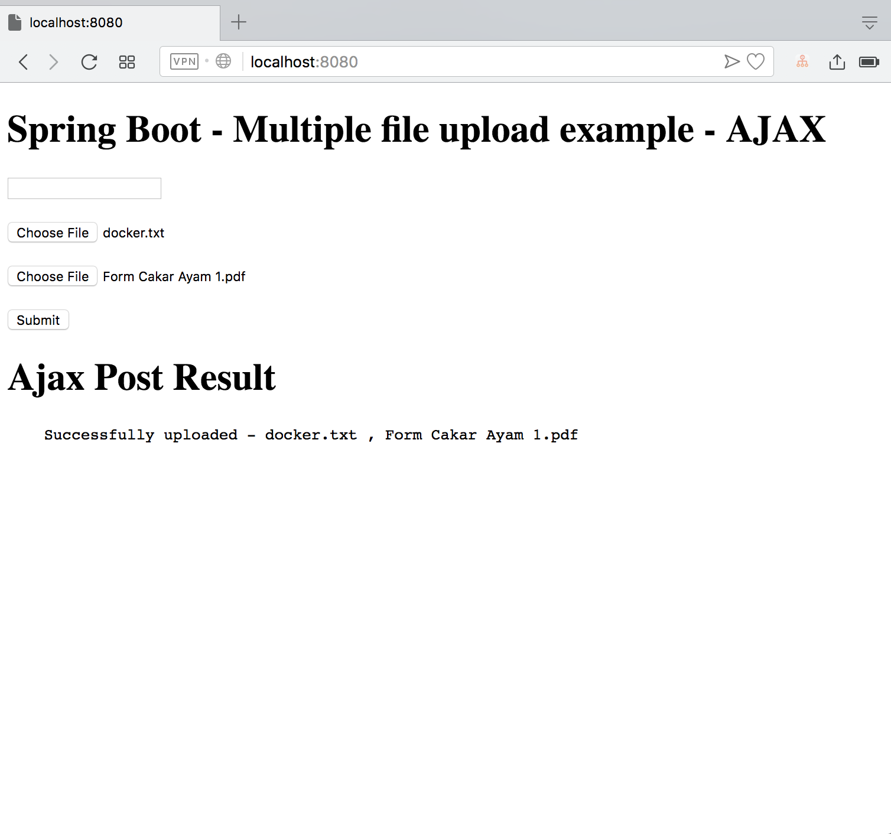

# spring-boot-file-upload-ajax-rest

[](https://github.com/hendisantika/spring-boot-file-upload-ajax-rest/actions/workflows/maven.yml)


A sample Spring Boot application that demonstrates **single & multiple file upload** via a **REST API** called with **jQuery Ajax** from a Thymeleaf page.



## Tech Stack

- Java **25**
- Spring Boot **4.1.x** (Web, Validation, Thymeleaf, DevTools)
- jQuery (via WebJars)
- Maven

## Prerequisites

- JDK 25 (e.g. [Eclipse Temurin](https://adoptium.net/))
- Maven 3.9+

Check your setup:

```bash
java -version
mvn -v
```

## Getting Started

Clone the repository:

```bash
git clone https://github.com/hendisantika/spring-boot-file-upload-ajax-rest.git
cd spring-boot-file-upload-ajax-rest
```

Run the application:

```bash
mvn clean spring-boot:run
```

Or build an executable jar and run it:

```bash
mvn clean package
java -jar target/spring-boot-file-upload-1.0.jar
```

Then open [http://localhost:8080](http://localhost:8080) in your browser.

## REST Endpoints

| Method | Endpoint                  | Parameters                                    | Description                           |
|--------|---------------------------|-----------------------------------------------|---------------------------------------|
| GET    | `/`                       | -                                             | Upload page (Thymeleaf)               |
| POST   | `/api/upload`             | `file` (multipart)                            | Upload a single file                  |
| POST   | `/api/upload/multi`       | `extraField` (text), `files` (multipart, [])  | Upload multiple files                 |
| POST   | `/api/upload/multi/model` | `extraField` (text), `files` (multipart, [])  | Upload multiple files mapped to model |

Uploaded files are saved to `/tmp/`.

### Example with cURL

```bash
# Single file
curl -F "file=@/path/to/file.txt" http://localhost:8080/api/upload

# Multiple files
curl -F "extraField=hello" \
     -F "files=@/path/to/file1.txt" \
     -F "files=@/path/to/file2.txt" \
     http://localhost:8080/api/upload/multi
```

## Continuous Integration

GitHub Actions ([`.github/workflows/maven.yml`](.github/workflows/maven.yml)) builds the project with **JDK 25 (Temurin)** on every push and pull request to `master`. On pushes to `master` it also submits the Maven dependency graph to improve Dependabot alerts.

## Dependency Updates

[Dependabot](.github/dependabot.yml) checks for updates **weekly (Monday 05:00 Asia/Jakarta)**:

- **Maven** — grouped into `spring-boot`, `webjars`, and `maven-minor-patch` PRs, labeled `dependencies` + `java`, with `chore(deps)` commit prefix.
- **GitHub Actions** — grouped into a single PR, labeled `dependencies` + `github-actions`, with `ci(deps)` commit prefix.

## Author

**Hendi Santika**

- Email: hendisantika@gmail.com
- Telegram: [@hendisantika34](https://t.me/hendisantika34)
- Link: [s.id/hendisantika](https://s.id/hendisantika)
